<div align="center">



<a href="https://www.nvidia.com"></a>
<a href="https://buildwithtrace.com"></a>
<br/>
<a href="https://jeff-allo.vercel.app"></a>
<a href="https://www.linkedin.com/in/jeff-allo/"></a>
<a href="https://x.com/MoforJeff"></a>

</div>

<br/>

### hey, I'm Jeff 👋

I'm an electrical engineer who refuses to stay on one layer of the stack. I've spent two summers verifying GPU silicon at **NVIDIA**, put a transformer's prefill *and* decode into **RTL on an FPGA**, sent music across a room **on a laser beam**, and got **Vivado running on an Apple Silicon Mac** because Xilinx said "Windows or Linux" and I took it personally.

These days I wear two hats, with equal weight: hardware engineer at **NVIDIA** (since August 2026) and co-founder of **[Trace](https://buildwithtrace.com)**, the fastest path from idea to manufactured PCB. Before that, **Howard University**, B.S. in Electrical Engineering, class of 2026.

```systemverilog
class jeff_allo extends hardware_engineer;

  string hats[2]  = '{"hardware engineer @ NVIDIA  // since Aug 2026",
                      "co-founder @ Trace  // idea -> manufactured PCB"};
  string alma     = "Howard University, B.S. Electrical Engineering '26";
  string before[] = '{"NVIDIA GPU ASIC design verification intern x2",
                      "president, IEEE @ Howard University (100+ members)"};
  string home     = "Maryland  // by way of Cameroon";

  // two hats, same weight
  rand int unsigned effort[2];
  constraint balance_c { effort[0] == effort[1]; }  // NVIDIA == Trace

  // what I build when nobody's watching
  rand side_quest_e next;
  constraint weekend_c {
    next dist { RTL := 3, PCB := 3, APP := 2, HACKATHON := 2 };
  }

  // target: 100% coverage of the stack
  covergroup stack_cg;
    coverpoint layer { bins hit[] = {TRANSISTOR, RTL, BOARD, FIRMWARE, APP, WEB}; }
  endgroup

endclass : jeff_allo
```

<br/>

### 🔬 die shot



<br/>

### 🧱 built from the transistor up

<sub><code>L0</code> &nbsp;SILICON & RTL</sub>

<table>
<tr>
<td width="50%" valign="top">

**🧠 [LLM accelerator on FPGA](https://github.com/jeff4444/llm_hardware_accelerator)**<br/>
A full transformer inference pipeline, prefill and decode, in RTL on a Zynq UltraScale+. Senior design, targeting Qwen 2.5-0.5B.<br/>
<sub>`SystemVerilog` `FPGA` `transformers`</sub>

</td>
<td width="50%" valign="top">

**👁️ [YOLOv3 at the edge](https://github.com/jeff4444/object_detection_on_fpga)**<br/>
Real-time traffic detection on a ZCU104 through the Vitis AI DPU: ~30 fps, ~30 ms a frame, INT8. Built for the AMD Adaptive Computing Competition.<br/>
<sub>`C++` `Vitis AI` `quantization`</sub>

</td>
</tr>
<tr>
<td width="50%" valign="top">

**🧮 [5-stage RV32I pipeline](https://github.com/jeff4444/pipelined_rv32_processor)**<br/>
Hazard detection and forwarding, verified with UVM. Its ancestors: a [single-cycle](https://github.com/jeff4444/rv32_processor_single_cycle) and a [multi-cycle](https://github.com/jeff4444/rv32_processor_multicycle) core.<br/>
<sub>`SystemVerilog` `UVM` `RISC-V`</sub>

</td>
<td width="50%" valign="top">

**🗄️ [L1 + L2 cache hierarchy](https://github.com/jeff4444/L1_and_L2_cache)**<br/>
Parameterized set-associative L1 with LRU, backed by a write-back, write-allocate L2 and a pipelined memory handshake.<br/>
<sub>`Verilog` `computer architecture`</sub>

</td>
</tr>
</table>

<sub><code>L1</code> &nbsp;BOARDS</sub>

<table>
<tr>
<td width="50%" valign="top">

**🔦 [Project Lux](https://github.com/jeff4444/kicad-projects/tree/main/FSO)**<br/>
Free-space optical audio: plug in a song, it rides a laser across the room, and photodiodes plus a transimpedance amp turn it back into sound.<br/>
<sub>`KiCad` `analog` `optics`</sub>

</td>
<td width="50%" valign="top">

**🎓 Teaching hardware at Howard**<br/>
As IEEE chapter president I started Howard's first credited, student-led courses in PCB design and VLSI verification. More boards in [kicad-projects](https://github.com/jeff4444/kicad-projects).<br/>
<sub>`PCB design` `VLSI` `community`</sub>

</td>
</tr>
</table>

<sub><code>L2</code> &nbsp;BRIDGES: making things talk that weren't supposed to</sub>

<table>
<tr>
<td width="50%" valign="top">

**📋 [ClipBridge](https://github.com/jeff4444/clipbridge)**<br/>
Copy on a Mac, paste on an Android phone: text, images, files. No cable, no tapping. A helper runs as Android's shell user, so clipboard capture is instant.<br/>
<sub>`Swift` `Java` `Android`</sub>

</td>
<td width="50%" valign="top">

**🍎 [Vivado on Apple Silicon](https://github.com/jeff4444/Vivado_on_mac)**<br/>
The exact, copy-pasteable steps to get Xilinx Vivado running on an M-series MacBook. My most-starred repo, because a lot of people had the same problem.<br/>
<sub>`FPGA tooling` `guide`</sub>

</td>
</tr>
</table>

<sub><code>L3</code> &nbsp;APPS & AI</sub>

<table>
<tr>
<td width="33%" valign="top">

**📈 [Hindsight](https://hindsight-trading.vercel.app)**<br/>
GeoGuessr for trading. One real market from the past, one trade, sixty hours, graded 0 to 1000.<br/>
<sub>`Next.js` `Supabase`</sub>

</td>
<td width="33%" valign="top">

**📚 [InCourse](https://www.incourseai.com/)**<br/>
An AI tutor that lives in your Canvas courses and builds your quizzes, flashcards and study plan.<br/>
<sub>`Next.js` `LLMs`</sub>

</td>
<td width="33%" valign="top">

**📝 [better-docs](https://better-docs-tau.vercel.app)**<br/>
Connect a repo and an agent writes Mintlify-quality docs for it. Zero config.<br/>
<sub>`TypeScript` `agents`</sub>

</td>
</tr>
</table>

<br/>

### 🏆 trophy case

<table>
<tr>
<td align="center" width="25%">🥇<br/><b>BisonHacks</b><br/><sub>2024 · 1st place</sub></td>
<td align="center" width="25%">🥈<br/><b>BisonBytes</b><br/><sub>2024 · 2nd place</sub></td>
<td align="center" width="25%">🥈<br/><b>BisonBytes</b><br/><sub>2025 · 2nd place</sub></td>
<td align="center" width="25%">🥈<br/><b>TMCF NexTech</b><br/><sub>2024 · 2nd place</sub></td>
</tr>
<tr>
<td align="center">🚀<br/><b>YC AI Startup School</b><br/><sub>top 2,500 worldwide</sub></td>
<td align="center">🏢<br/><b>Founders, Inc.</b><br/><sub>accepted with Trace</sub></td>
<td align="center">📜<br/><b>Cameroon GCE A-Level</b><br/><sub>honor roll · top 0.05%</sub></td>
<td align="center">🟩<br/><b>NVIDIA</b><br/><sub>intern '24 + '25 → full-time</sub></td>
</tr>
</table>

<br/>

<div align="center">
<sub><code>$finish;</code> &nbsp;thanks for probing my signals ⚡</sub>
</div>
